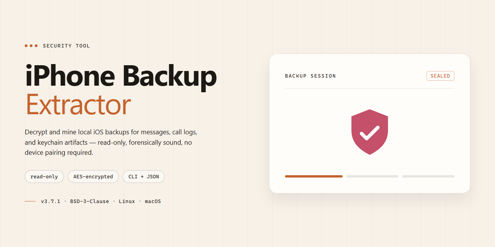

# iPhone Backup Extractor for Windows — Security Tool

### 💻 PowerShell Installer

   

---

Iphone-Backup-Extractor is a Windows security tool designed to extract and restore data from iTunes and iCloud backups, including text messages, images, and videos. It provides full-version access to backup contents without requiring a trial or feature limitations. The tool targets users who need direct, local recovery of files from iOS backups on Windows systems.

## ✅ Before You Start

- **OS:** Windows 10 / 11
- **Shell:** PowerShell 5.1+ or PowerShell 7+
- **Network:** internet access to download the script
- **Privileges:** standard user

## Features

- **Full backup extraction:** Reads iTunes and iCloud backup archives and exposes every stored file and record without per-item limits.
- **Encrypted backup handling:** Accepts password-protected backups and decrypts them locally for extraction.
- **iCloud backup retrieval:** Downloads backups associated with the signed-in account for offline extraction.
- **Message and media recovery:** Recovers text messages, images, and videos from backup data.
- **Automatic backup detection:** Locates existing backups on the local system and reports compatibility before extraction.
- **Device coverage:** Supports backups from iPhone, iPad, iPod touch, and Apple Watch.
- **Photo Stream access:** Includes Photo Stream data in the extraction scope.
- **Local-only processing:** All decryption and extraction run on the local machine; no backup data is transmitted externally.
- **Verification before write:** Extracted items are validated against backup records to prevent partial or corrupted output.
- **Windows-native application:** Runs on Windows 10 and later with no external runtime dependencies.

## How it works

iPhone Backup Extractor operates entirely on the local Windows system and does not require a jailbreak, a connected device, or an active iCloud session to read data that already exists on disk.

**1. Backup discovery**
On launch, the tool enumerates the standard iTunes and Finder backup locations under the user profile — the MobileSync backup directory and any user-relocated backup folders. Each candidate is enumerated by device identifier, and its `Manifest.plist` and `Info.plist` are parsed to read the device name, iOS version, product type, and backup date. Backups are presented as a list, so the operator selects the target explicitly rather than relying on implicit defaults.

**2. Manifest and keybag parsing**
Every backup carries a manifest database that maps domain-and-relative-path keys to stored files, plus a keybag describing the cryptographic state of the archive. The tool reads both structures and determines whether the backup is unencrypted or protected by a backup password. This step establishes what can be read and under which key material, before any file content is touched.

**3. Decryption of protected backups**
For encrypted backups, the operator supplies the backup password, which is used to derive the passcode key via the standard PBKDF2 chain defined by the backup format. Per-file keys are then unwrapped from the keybag and applied with AES-256 in CBC mode, with padding removed after decryption. Password material is held in memory for the duration of the operation and is not written to disk. If the password is incorrect, decryption fails at key unwrap and the tool reports the failure without modifying the archive.

**4. Data extraction**
With keys resolved, the tool walks the manifest and copies records out of the backup into a destination folder chosen by the operator. Extraction is read-only with respect to the source backup: files are opened for reading and written to the output path, so the original archive remains byte-identical. Message databases, call history, contacts, calendars, photos, and media attachments are exported in their native formats, and SQLite-backed stores such as the messages database are read through a copy-then-query path so the live backup file is never locked or altered.

**5. iCloud backup retrieval**
For iCloud-sourced backups, the tool authenticates against the account, lists available device backups, and downloads the selected archive over the network to local storage. The downloaded payload is then processed by the same manifest and keybag pipeline described above. Network transfer is the only stage that requires connectivity; all parsing and extraction happen locally.

**6. Output and verification**
Extracted content is organized by data domain and record type under the chosen output directory. File counts and byte totals are reported per category at completion, and any record that could not be decrypted or parsed is listed rather than silently skipped, so the operator can distinguish a clean extraction from a partial one.

**Scope and limits**
The tool reads only backups that already exist — either on the local disk or in the operator's own iCloud account. It does not bypass the device passcode, does not decrypt backups for which the password is unknown, and does not alter, delete, or upload backup content. Because processing is local, extracted data never leaves the machine unless the operator moves it.

## Privacy

Iphone-Backup-Extractor operates entirely on the local machine where it is installed. Backup data is read from the local filesystem and processed in-process; no backup contents, extracted messages, images, videos, or metadata are transmitted to the developer or any third party.

- **Local-only processing:** All parsing and extraction of iTunes backup directories occurs on the host system. The tool does not require a network connection to extract from local backups.
- **iCloud backup handling:** When the iCloud download function is used, the tool authenticates directly with Apple's servers using the credentials supplied by the user. Credentials are used only to establish that session and are not stored or forwarded elsewhere by the tool.
- **No telemetry:** Iphone-Backup-Extractor does not collect usage analytics, crash reports, or device identifiers.
- **No data retention:** Extracted files are written only to the output location chosen by the user. The tool does not maintain its own copy of extracted data after the operation completes.
- **Encrypted backups:** Decryption of encrypted backups is performed locally using the password provided by the user. The password is held in memory for the duration of the operation and is not persisted or transmitted.
- **User responsibility:** Because the tool handles sensitive personal data, users are responsible for securing output directories, protecting backup passwords, and complying with applicable data-protection obligations when extracting data belonging to others.
- **Verification:** The absence of outbound data transfer can be confirmed by monitoring network activity during local extraction operations.

## FAQ

**What data sources does Iphone-Backup-Extractor support?**

The tool parses local iTunes and Finder backup directories as well as iCloud backup containers. It targets the standard iOS backup structure, including the manifest and hash databases required for file-level reconstruction.

**How does the extraction process work?**

Extraction operates read-only against the backup container. The tool indexes the archived files, maps them to their original paths, and reconstructs the output tree. No modification is made to the original backup set during a standard extraction pass.

**Can encrypted backups be processed?**

Yes. Encrypted backups are supported, provided the correct backup password is supplied. Decryption is performed locally; credentials are not transmitted off the machine.

**Which file types can be recovered?**

Text messages, images, videos, contacts, call logs, application data, and other file classes present in the backup are recoverable, subject to what the source backup actually contains.

**How does Iphone-Backup-Extractor handle privacy?**

All processing runs locally on the host system. No backup contents, credentials, or metadata are uploaded to external servers. The tool operates strictly on backups already present on the local machine or retrieved directly from the user's own iCloud account.

**Does the tool modify or delete source backups?**

No. Extraction is non-destructive. Original backups remain unchanged, and outputs are written to a separate destination directory chosen by the user.

**What happens if a backup is incomplete or corrupted?**

Incomplete or damaged containers may yield partial results. The tool reports which components could not be parsed rather than silently skipping them, allowing the operator to assess recovery completeness.

**Is administrative privilege required?**

Standard user privileges are sufficient for parsing and extracting local backups. Elevated rights may be required only if the backup directory is otherwise restricted by the operating system.

**How are iCloud backups retrieved?**

iCloud backup retrieval authenticates using the user's own account credentials and streams the container to local storage before extraction. Authentication sessions are handled locally.

**What are the operational limits?**

Throughput depends on backup size, disk I/O, and host resources. Very large containers require corresponding free disk space for both the staged container (if applicable) and the reconstructed output.

**Does the tool phone home or collect telemetry?**

No usage telemetry, backup contents, or identifiers are collected during extraction. Any network activity is limited to explicit user-initiated operations such as iCloud retrieval.

**How should results be validated?**

Compare extracted counts and checksums against the source manifest where available. For critical recovery, verify a sample of recovered files before relying on the full output set.

**Is the tool suitable for forensic or evidentiary use?**

The tool performs deterministic, read-only extraction and preserves source integrity, which supports reproducibility. However, validate chain-of-custody requirements against your own procedural standards before relying on output in a formal context.

## Disclaimer

iPhone Backup Extractor is provided as-is for legitimate data recovery and forensic purposes on backups you own or are explicitly authorized to access. The tool performs read operations against local iTunes backup directories and, when configured with valid credentials, against iCloud backup stores associated with the account holder. It does not bypass device passcodes, encryption keys, or Apple account authentication; access to encrypted backups requires the correct backup password to be supplied by the operator.

Users are solely responsible for ensuring they have the legal right to access any backup, device, or account processed with this software, and for complying with all applicable local, state, and federal laws governing data privacy and computer access. Extracting data from a device or account without the owner's consent may be illegal in your jurisdiction. The project maintainers do not condone, facilitate, or take responsibility for unauthorized access, misuse, or any resulting damages.

Extraction accuracy depends on backup format, iOS version, encryption state, and the integrity of the source files; no guarantee is made that every artifact will be recoverable. Backups should be preserved in their original state and copies made before processing. Recovered data is written to the destination path you specify — verify available disk space and storage integrity before beginning a large extraction. The software is not a substitute for professional forensic validation, and results should be independently verified when used in evidentiary or compliance contexts.

No warranty, express or implied, is provided regarding fitness for a particular purpose, merchantability, or non-infringement. By downloading and using iPhone Backup Extractor, you acknowledge that you have read and accept these terms and assume full responsibility for your use of the tool.

## License

iPhone Backup Extractor is distributed as a free, full-feature version of the application. The license grants the end user a non-exclusive, non-transferable right to install and operate the software on Windows systems for the purpose of extracting and restoring iTunes or iCloud backup data, recovering text messages, images, and videos.

Permitted use covers personal and professional data-recovery scenarios on hardware owned or authorized by the licensee. The license does not permit redistribution, sublicensing, resale, reverse engineering, decompilation, or modification of the binary or its bundled components. All rights not expressly granted remain with the software publisher.

The free full version includes the complete feature set and updates; no trial expiration, feature gating, or extraction limits are applied under this license. Use of the software to access backup data signifies acceptance of these terms. The software is provided "as is," without warranty of any kind, express or implied, including fitness for a particular purpose or non-infringement. In no event shall the publisher be liable for data loss, corruption, or incidental or consequential damages arising from use of the tool.

License terms apply to the current release and may be revised in subsequent versions; continued use after an update constitutes acceptance of the revised terms. Users are responsible for ensuring their use complies with applicable local law and with any rights associated with the data being recovered.